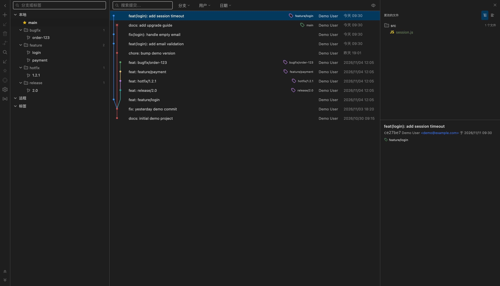
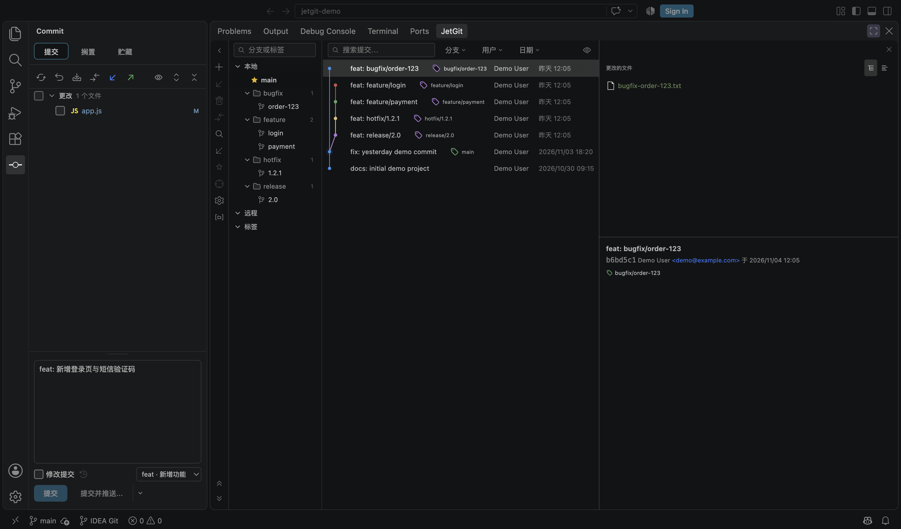
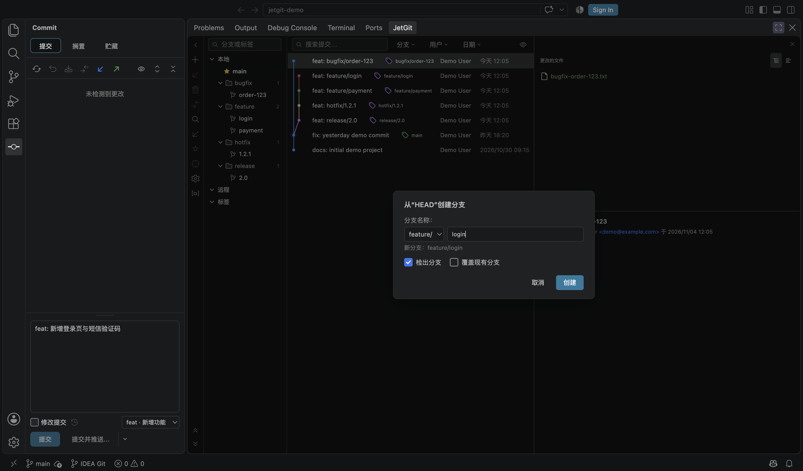

<div align="center">


# Git Graph (JetBrains)

**IntelliJ-style Git graph, commit panel and shelf for VS Code / Cursor — with a full Simplified Chinese UI.**

[](./LICENSE)
[](https://code.visualstudio.com/)
[](https://marketplace.visualstudio.com/items?itemName=jiuxianzai.git-graph-jetbrains)

[English](./README.md) · [简体中文](./README.zh_CN.md)

</div>

---

## ⚠️ Fork notice & attribution

This repository is a **community fork**, not the original project.

- **Forked from:** [`aotemj/jetbrains-git-graph`](https://github.com/aotemj/jetbrains-git-graph)  
  (the upstream project this fork is based on, at version `0.4.17`)
- **Which itself is a fork of:** [`zhyc9de/jet-git`](https://github.com/zhyc9de/jet-git)
- **This fork:** [`jiuxianzai/git-graph-jetbrains`](https://github.com/jiuxianzai/git-graph-jetbrains)
- **Marketplace ID:** `jiuxianzai.git-graph-jetbrains`

The original code and UI are the work of the upstream authors. This fork keeps
the MIT license and the original copyright notices (see [`LICENSE`](./LICENSE)),
and adds the changes listed below.

**Trademark disclaimer:** this is an independent, unofficial project. It is **not
affiliated with, endorsed by, or sponsored by JetBrains s.r.o., Microsoft
Corporation, or Anysphere (Cursor)**. “JetBrains”, “IntelliJ IDEA”, “WebStorm”,
“PyCharm”, “GoLand” and “Rider” are trademarks of JetBrains s.r.o. “Visual Studio
Code” is a trademark of Microsoft Corporation. All trademarks are used only to
describe compatibility and inspiration.

---

## What this fork changes

Compared with the upstream `aotemj/jetbrains-git-graph` at `0.4.17`:

| Area | Change |
| --- | --- |
| **Internationalization** | Complete English + Simplified Chinese UI. New `jetgit.language` setting (`auto` / `en` / `zh-cn`); `auto` follows the VS Code display language. Manifest strings are localized via `package.nls*.json`. |
| **Branch tree** | Branches are grouped by `/` prefix into collapsible folders (`feature/login` → `feature ▸ login`) with branch counts and full-path tooltips. Directory grouping is on by default; an explicit flat-list choice is remembered. |
| **Current branch** | Pinned as the first row under **Local**, marked with a filled yellow star on the left. The old `当前分支: xxx` header was removed; the branch is no longer duplicated inside its folder. |
| **New branch dialog** | Prefix picker for `feature/`, `bugfix/`, `hotfix/`, `release/`, `chore/`; the last used prefix is remembered. Typing a name containing `/` keeps it as a full path. |
| **Commit message box** | Defaults to about **1/3 of the panel height**, with a drag grip to resize, double-click to reset, and per-panel height persistence. |
| **Conventional Commits** | Type dropdown (`feat`, `fix`, `docs`, `style`, `refactor`, `perf`, `test`, `build`, `ci`, `chore`, `revert`) that writes the `type: ` prefix. Switching types rewrites only the prefix and preserves `(scope)` and `!`. |
| **Git log layout** | Header row removed; smaller typography; author/date/hash left-aligned; hash hidden by default (toggle in the toolbar eye menu); default column split is **22% branch tree / 54% commit list / 24% details**, remembered per workspace. |
| **Dates** | Today → `今天 HH:mm`, yesterday → `昨天 HH:mm`, older → `YYYY/MM/DD HH:mm`; full timestamp on hover. Author/date columns are measured to fit their content. |
| **Wide commits** | When the log genuinely overflows, the **branch graph and message scroll together horizontally** while **author/date stay pinned** on the right. Long refs are shown next to the subject with ellipsis and tooltips. |
| **Interaction fixes** | Double-clicking a file in the commit panel no longer selects its text. Merge/rebase context-menu labels no longer end with `?` (the question mark stays in the confirmation dialog). |
| **Worktree-aware checkout** | When a branch is checked out in another worktree, checkout shows a clear message and offers to **open that worktree in a new window**. Dirty-tree conflicts are explained instead of failing silently. |
| **Packaging** | Renamed to `jiuxianzai.git-graph-jetbrains` for this fork, starting at `1.0.0`; the current release is `1.0.5`. |

Everything else — the Git graph engine, commit/shelf panel, 3-way merge
editor, conflict management, cherry-pick/rebase/merge actions, file history and
context menus — comes from the upstream project.

---

## Screenshots

### Git Log — Chinese UI, prefix folders, pinned current branch



### Conventional Commit type picker



### New branch with prefix picker



---

## Features inherited from upstream

- **Git graph** with lane layout, refs, tags and collapsible linear sequences
- **IDEA-style commit panel** with changelists, shelf and stash support
- **Branch management**: checkout, new branch, rename, delete, push, pull, compare
- **Commit actions**: cherry-pick, revert, reset (soft/mixed/hard), drop commit, create branch/tag
- **3-way merge editor** and conflict list
- **Changed-files context menu**: show diff, edit source, open repository version, copy path
- **File history** from the editor/explorer context menu

---

## Changelog / 更新日志

### 1.0.5 — 2026-11-09

- **Push no longer fails silently** — Push/network requests get a 5-minute timeout instead of the old 10-second limit, failed pushes keep the dialog open with the git error, and the branch's real default remote is used instead of a hard-coded `origin`.
  / **推送不再静默失败** — 推送及网络请求的超时从固定 10 秒改为 5 分钟；推送失败时弹窗保持打开并显示 git 错误；同时使用分支实际的默认远程，不再写死 `origin`。
- **Pull works on diverged branches** — `git pull` now passes an explicit merge strategy (`--no-rebase`), so a rebased/diverged `main` no longer dies with “Need to specify how to reconcile divergent branches”.
  / **分叉分支可以正常拉取** — `git pull` 现在显式使用合并策略（`--no-rebase`），变基后与远程分叉的 `main` 不会再因为 “Need to specify how to reconcile divergent branches” 失败。
- **Visible progress and result feedback** — Push shows a labeled progress bar and an in-dialog “Pushing…” state; update/merge/rebase failures now surface as a toast with the actual git error instead of only being written to the console.
  / **进度与结果反馈** — 推送时显示带分支名的进度条和弹窗内“正在推送…”状态；更新、合并、变基失败会通过右上角 toast 显示真实 git 错误，而不是只写进 console。
- **Push toast cleanup** — The result toast moved to the top-right (away from VS Code's native bottom-right notifications) and was restyled as a borderless rounded card; the duplicate native notification on success was removed.
  / **推送提示优化** — 结果 toast 移到右上角，避开 VS Code 右下角原生通知；改为无边框圆角卡片，并去掉成功时重复的原生通知。
- **Release packaging** — Versioned VSIX files are now stored under `releases/v<version>/`; the release script writes there automatically.
  / **发布包归档** — 各版本 VSIX 统一存放到 `releases/v<version>/`，发布脚本会自动写入该目录。

Older releases are documented in [`CHANGELOG.md`](./CHANGELOG.md).
更早版本见 [`CHANGELOG.md`](./CHANGELOG.md)。

---

## Installation

**From the Marketplace:**

```
ext install jiuxianzai.git-graph-jetbrains
```

or search for **Git Graph (JetBrains)** in the Extensions view.

**From a VSIX:**

```bash
code --install-extension git-graph-jetbrains-1.0.5.vsix
```

> If you previously installed `autemj.idea-like-git-graph`, the two extensions
> have different IDs and can coexist. Disable one of them to avoid duplicate
> views and context-menu entries.

---

## Settings

| Setting | Values | Default | Description |
| --- | --- | --- | --- |
| `jetgit.language` | `auto`, `en`, `zh-cn` | `auto` | UI language. `auto` follows the VS Code display language. Changing it prompts for a window reload. |

---

## Requirements

- VS Code `1.85.0` or newer
- Git installed and available in `PATH`

---

## Build from source

```bash
pnpm install
cd webview && pnpm install && cd ..

pnpm run compile      # type-check + lint + extension bundle
pnpm run build:web    # webview bundle
pnpm run vsce:package # produce a .vsix
```

---

## Credits & license

- Original project: [`zhyc9de/jet-git`](https://github.com/zhyc9de/jet-git)
- Upstream fork this work is based on: [`aotemj/jetbrains-git-graph`](https://github.com/aotemj/jetbrains-git-graph)
- This fork: [`jiuxianzai/git-graph-jetbrains`](https://github.com/jiuxianzai/git-graph-jetbrains)

MIT License. Original copyright notices are preserved in [`LICENSE`](./LICENSE).
