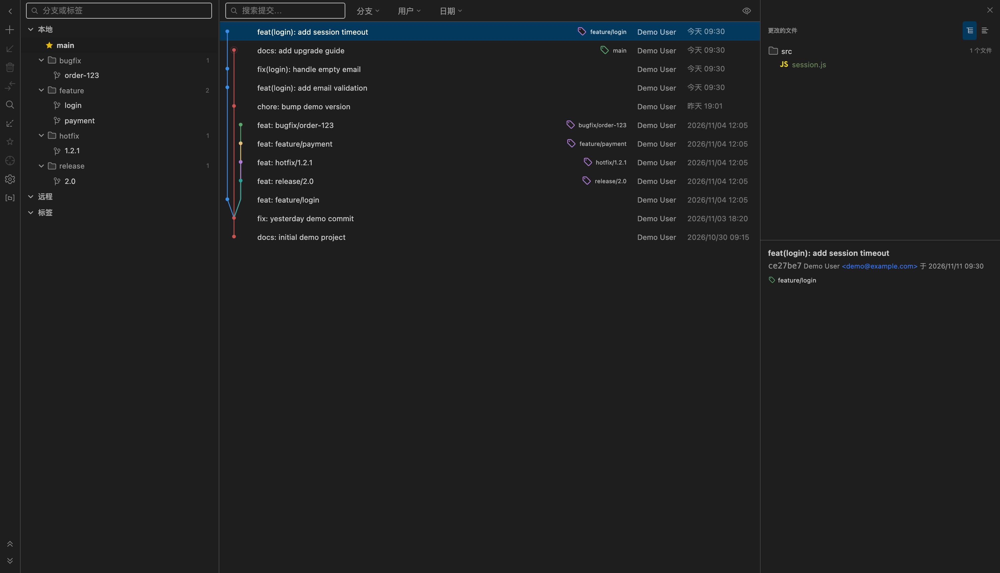
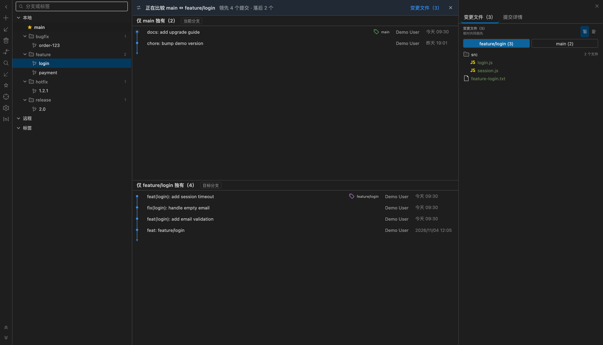
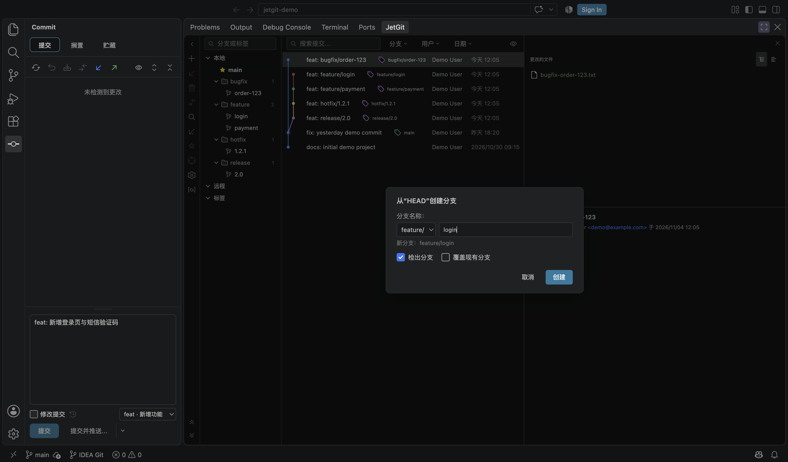
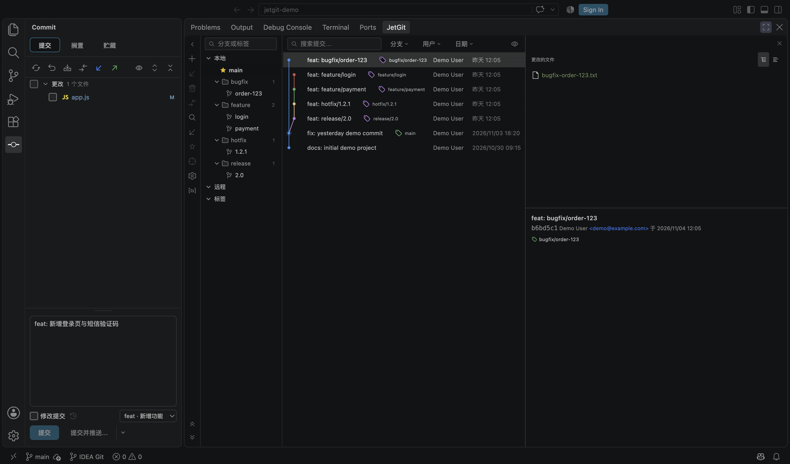

<div align="center">


# Git Graph (JetBrains)

**把 IntelliJ 风格的 Git 图谱、提交面板与 Shelf 带到 VS Code / Cursor —— 新增分支比较，并提供完整简体中文界面。**

[](./LICENSE)
[](https://code.visualstudio.com/)
[](https://marketplace.visualstudio.com/items?itemName=jiuxianzai.git-graph-jetbrains)
[](https://github.com/jiuxianzai/git-graph-jetbrains/releases)

[English](./README.md) · [简体中文](./README.zh_CN.md)

</div>

> 本项目是 [`aotemj/jetbrains-git-graph`](https://github.com/aotemj/jetbrains-git-graph) 的社区分支，基于其 `0.4.17` 版本。署名与详细改动见 [关于本分支](#关于本分支)。

---

## 目录

- [概览](#概览)
- [截图](#截图)
- [分支比较](#分支比较)
- [功能](#功能)
  - [Git 日志与图谱](#git-日志与图谱)
  - [分支树](#分支树)
  - [提交面板与 Shelf](#提交面板与-shelf)
  - [合并与冲突](#合并与冲突)
  - [提交操作](#提交操作)
  - [文件历史与差异](#文件历史与差异)
- [安装](#安装)
- [快速上手](#快速上手)
- [设置](#设置)
- [环境要求](#环境要求)
- [更新日志](#更新日志)
- [关于本分支](#关于本分支)
- [开发](#开发)
- [致谢与协议](#致谢与协议)

---

## 概览

Git Graph (JetBrains) 把 IntelliJ / WebStorm 的 Git 工作流带进 VS Code 和 Cursor：

- 清晰可读的**提交图谱**：分支车道、refs、标签；
- IDEA 风格的**提交面板**：更改列表、Shelf、Stash；
- **三方合并编辑器**与冲突列表；
- **分支比较视图**（1.1 新增）：查看一个分支相对另一个分支多出/缺少哪些提交；
- 完整的**英文 + 简体中文**界面。

扩展直接调用工作区里的 `git` 命令，因此在 macOS、Windows、Linux 上行为一致。

## 截图

### Git 日志：图谱、按前缀分组的分支树、提交详情



### 分支比较：当前分支 vs `feature/login`



## 分支比较

不用离开面板，就能把任意分支与当前检出的分支做比较。

**入口：** 在分支树里右键任意本地/远程分支 → **比较差异**；侧边栏的“与当前分支比较”按钮效果相同。

你会得到：

- **上下分屏的提交列表**：上栏只显示当前分支独有的提交，下栏只显示被比较分支独有的提交；两边各自带提交图、独立滚动，中间分隔条可拖动。
- **领先 / 落后数量**：顶部显示相对共同祖先的差异，例如 `feature/login` 领先 4 个、落后 2 个。
- **两侧变更文件**：详情面板新增「变更文件」标签页，可在目标分支 / 当前分支之间切换；点击文件打开相对共同祖先的左右对比（三点语义），不会把对方分支的改动显示成反向修改。
- **提交详情仍然可用**：点任意一栏的提交即可在「提交详情」里查看；上一个/下一个文件差异的导航也保留。
- **随时退出**：点 `×` 或按 **Esc**，普通日志和进入比较前的过滤状态都会恢复。

比较过程是只读的，只执行 `git log`、`git merge-base`、`git rev-list` 和 `git diff`。支持本地与远程分支；detached HEAD 时会回退到 `HEAD`。

## 功能

### Git 日志与图谱

- 基于车道的提交图谱，包含分支/标签 refs 与合并线。
- 可折叠的线性提交序列——点击序列线即可隐藏中间提交。
- 按提交信息、作者、日期范围、分支、文件历史过滤。
- 大仓库分页加载，跨页车道布局保持稳定。
- 作者 / 日期 / 哈希列可切换；横向滚动时作者与日期固定在右侧。
- 人性化日期（`今天 09:30`、`昨天 18:20`、`2026/10/01 12:05`），悬停显示完整时间。

### 分支树

- 按 `/` 前缀折叠成目录（`feature/login` → `feature ▸ login`），显示目录内分支数量与完整路径提示。
- 当前分支固定排在「本地」第一行，用黄色实心星标标记。
- 新建分支支持前缀选择（`feature/`、`bugfix/`、`hotfix/`、`release/`、`chore/`），并记住上次选择。



### 提交面板与 Shelf

- IDEA 风格更改列表：暂存/取消暂存、单文件回滚与差异操作。
- **Shelve / Unshelve** 与 Stash，支持补丁导入/导出。
- Conventional Commits 类型选择（`feat`、`fix`、`docs`、`style`、`refactor`、`perf`、`test`、`build`、`ci`、`chore`、`revert`）；切换类型只替换前缀，保留 `(scope)` 与 `!`。
- 可拖动的提交信息框（默认约占面板 1/3，双击把手复位，按面板记忆高度）。
- 提交、提交并推送，以及带进度与错误反馈的完整推送面板。



### 合并与冲突

- 内置三方合并编辑器（base / ours / theirs），逐冲突解决。
- 冲突列表，支持接受当前/接受对方。
- 能识别中断的 merge / rebase 状态，并提供回到干净状态的入口。

### 提交操作

- 检出（感知 worktree）、新建分支、重命名、删除。
- 推送、拉取、抓取、变基、合并。
- Cherry-Pick、Revert、Reset（soft / mixed / hard）、Drop Commit。
- 从任意提交创建分支或标签。

### 文件历史与差异

- 在编辑器与资源管理器右键查看文件历史。
- 上一个 / 下一个文件差异命令（macOS 上为 `Cmd+F7` / `Cmd+Shift+F7`），逐个查看提交内文件。
- 更改文件右键菜单：查看差异、编辑源文件、打开仓库版本、复制路径。

## 安装

**插件市场：**

```
ext install jiuxianzai.git-graph-jetbrains
```

或在扩展市场搜索 **Git Graph (JetBrains)**。

**从 VSIX 安装：**

```bash
code --install-extension git-graph-jetbrains-1.1.0.vsix
```

最新 VSIX 见 [GitHub Releases](https://github.com/jiuxianzai/git-graph-jetbrains/releases)。

> 如果之前安装过 `autemj.idea-like-git-graph`，两者 ID 不同可以共存；
> 建议只启用其中一个，避免出现重复的视图和右键菜单。

## 快速上手

1. **打开日志** —— 点底部面板的 **JetGit** 标签，或在命令面板执行 `JetGit: Focus on Git Log View`。
2. **浏览** —— 用分支树和工具栏过滤缩小范围；点提交在右侧查看文件与详情。
3. **比较分支** —— 右键分支 → **比较差异**；在详情面板切换变更文件侧；按 `Esc` 退出。
4. **提交** —— 打开活动栏的 **提交** 视图，检查更改，写 Conventional Commit 信息并提交。
5. **语言** —— 把 `jetgit.language` 设为 `en` 或 `zh-cn`（默认 `auto` 跟随 VS Code 显示语言；修改后需重载窗口）。

## 设置

| 设置 | 可选值 | 默认 | 说明 |
| --- | --- | --- | --- |
| `jetgit.language` | `auto`、`en`、`zh-cn` | `auto` | 界面语言。`auto` 跟随 VS Code 显示语言；修改后会提示重载窗口。 |

## 环境要求

- VS Code `1.85.0` 或更高（也兼容 Cursor 等 VS Code 系编辑器）。
- 已安装 Git，且 `git` 在 `PATH` 中。

## 更新日志

### 1.1.0 — 2026-11-11

- **分支比较（上下分屏）** —— 任意分支与当前分支对比，两侧各自带提交图、领先/落后数量，分隔条可拖动。
- **两侧变更文件 + 三点 diff** —— 分别查看两侧相对共同祖先的改动，并逐文件打开对比。
- **修复** —— 文件列表中的中文/空格路径、长分支名挤掉提交标题、窄面板下横幅与标签页被裁切。

完整双语历史见 [`CHANGELOG.md`](./CHANGELOG.md)，可下载的 VSIX 见 [GitHub Releases](https://github.com/jiuxianzai/git-graph-jetbrains/releases)。

## 关于本分支

本仓库是**社区分支**，不是原始项目。

- **Fork 自：** [`aotemj/jetbrains-git-graph`](https://github.com/aotemj/jetbrains-git-graph)（`0.4.17`）
- **最初来源：** [`zhyc9de/jet-git`](https://github.com/zhyc9de/jet-git)
- **本分支仓库：** [`jiuxianzai/git-graph-jetbrains`](https://github.com/jiuxianzai/git-graph-jetbrains)
- **插件市场 ID：** `jiuxianzai.git-graph-jetbrains`

原始代码与界面的版权归上游作者所有。本分支保留 MIT 协议与原始版权声明（见 [`LICENSE`](./LICENSE)）。

| 方面 | 改动 |
| --- | --- |
| **分支比较** | 右键任意分支 → **比较差异**：上下分屏（当前分支独有 / 目标分支独有）、领先落后计数、两侧变更文件、相对共同祖先的三点 diff、可拖动分隔条、`Esc` 退出。 |
| **多语言** | 完整英文 + 简体中文界面；`jetgit.language`（`auto` / `en` / `zh-cn`），`auto` 跟随 VS Code 显示语言；插件清单通过 `package.nls*.json` 本地化。 |
| **分支树** | 按 `/` 前缀折叠成目录（`feature/login` → `feature ▸ login`），显示目录内分支数量与完整路径提示；目录分组默认开启，手动切平铺后会记住。 |
| **当前分支** | 固定排在「本地」第一行，最左侧用黄色实心星标标记；移除顶部「当前分支：xxx」标题，且不再在文件夹中重复出现。 |
| **新建分支** | 支持前缀选择：`feature/`、`bugfix/`、`hotfix/`、`release/`、`chore/`，记住上次选择；输入含 `/` 的名称按完整路径处理。 |
| **提交信息框** | 默认约占面板高度 **1/3**，上方拖动把手可调整，双击恢复默认，并按面板记住高度。 |
| **Conventional Commits** | 类型下拉框写入 `type: ` 前缀；切换类型只替换前缀，保留 `(scope)` 与 `!`。 |
| **日志布局** | 去掉表头；整体字号更小；作者/日期/哈希左对齐；哈希列默认不显示（工具栏可开）；默认列宽比例 **分支树 22% / 提交列表 54% / 详情 24%**，按工作区记忆。 |
| **日期** | 今天显示 `今天 HH:mm`，昨天 `昨天 HH:mm`，更早 `YYYY/MM/DD HH:mm`；悬停显示完整时间；作者/日期列按内容自动定宽。 |
| **横向滚动** | 日志确实放不下时，图谱与消息一起横向滚动，作者/日期固定在右侧；长分支标签省略并可悬停查看。 |
| **交互修复** | 提交面板双击文件不再选中文字；合并/变基右键菜单项不再以 `?` 结尾。 |
| **Worktree 检出** | 分支已在其他 worktree 检出时给出明确提示，并询问是否在新窗口打开该 worktree；未提交更改冲突也会说明原因。 |
| **打包** | 本分支重命名为 `jiuxianzai.git-graph-jetbrains`，从 `1.0.0` 开始发布；当前版本为 `1.1.0`。 |

**商标声明：** 本项目是独立、非官方项目，与 JetBrains s.r.o.、Microsoft Corporation、Anysphere（Cursor）没有任何隶属、背书或赞助关系。“JetBrains”“IntelliJ IDEA”“WebStorm”“PyCharm”“GoLand”“Rider” 是 JetBrains s.r.o. 的商标；“Visual Studio Code” 是 Microsoft Corporation 的商标。相关名称仅用于说明兼容性与设计灵感。

## 开发

```bash
pnpm install
cd webview && pnpm install && cd ..

pnpm run compile      # 类型检查 + lint + 扩展打包
pnpm run build:web    # Webview 打包
pnpm run build        # 两者
pnpm run package      # 生产版扩展打包
pnpm run vsce:package # 生成 .vsix
```

发布辅助脚本（构建 + VSIX + 插件市场上传）：

```bash
pnpm run release:dry       # 只构建和打包
pnpm run release:rehearse  # 打开上传对话框，停在 Upload 前
pnpm run release           # 正式发布
```

## 致谢与协议

- 最初项目：[`zhyc9de/jet-git`](https://github.com/zhyc9de/jet-git)
- 本分支所基于的上游：[`aotemj/jetbrains-git-graph`](https://github.com/aotemj/jetbrains-git-graph)
- 本分支：[`jiuxianzai/git-graph-jetbrains`](https://github.com/jiuxianzai/git-graph-jetbrains)

MIT 协议，原始版权声明保留在 [`LICENSE`](./LICENSE) 中。
